# DRAM (1T1C) and SRAM (6T) cell characterization in SKY130, with a SystemVerilog real-number model

Transistor-level characterization of a folded-bitline 1T1C DRAM column and a 6T SRAM
cell in the open-source SkyWater 130 nm process (ngspice + BSIM4 models). It covers
read/write/restore timing, retention vs. temperature, PVT corners and Monte Carlo
mismatch. The DRAM sense amplifier is then abstracted into a **SystemVerilog
real-number model (RNM)** calibrated against SPICE and checked against it.

Every number and plot below is regenerated by one command (`./run_all.sh`).

**Highlights**

- Found and fixed three design problems with root causes: a **slow equalize**
  (bitlines still 90 mV apart 4 ns into precharge), an **incomplete restore of
  "1"** (1.70 V of 1.8 V), and a **sense-amp failure at ss / −40 °C / 1.62 V**.
- Showed that the obvious fix for the sense-amp failure (low-Vt devices) **doubles
  the offset (σ 10.8 → 18.8 mV) and leaves no 6σ margin**. Upsizing the
  standard-Vt latch fixes it with 60 mV of 6σ margin left.
- Measured a **+10.6 mV systematic offset** from wordline coupling, which only
  reaches the cell's own bitline.
- The real-number model matches SPICE on **44/44 decisions with 2 ps rms timing
  error**. It runs 240,000 statistical reads in 1.8 s, and its predicted failure
  rate matches the SPICE Monte Carlo.

---

## 1. Circuits

**DRAM column slice (folded bitline):**
- **Cell:** an access NMOS (W/L 0.42/0.15 µm) plus a 20 fF storage capacitor to a plate at VDD/2.
- **Bitlines:** BL and BLB at 100 fF each.
- **Precharge/equalize:** 3 NMOS to VBLP = VDD/2.
- **Sense amp:** cross-coupled latch. NMOS sources on SAN, PMOS sources on SAP, with the NMOS half fired first.
- **Column select:** NMOS pass gates to the I/O lines, which carry the write driver.
- **Supplies:** VDD 1.8 V, boosted wordline VPP 2.6 V.

**SRAM cell:** 6T with PD/PG/PU = 0.84/0.42/0.42 µm, L = 0.15 µm. That gives a cell ratio β = 2 and a pull-up ratio of 1. The PMOS is about 2.5× weaker than the NMOS.

**Simplifications (stated, not hidden):**
- Lumped bitline capacitance.
- Ideal SAN/SAP enable ramps.
- Ideal VPP.
- No layout parasitics.
- Mismatch is threshold-voltage only (see §6).

## 2. M1: read, restore, precharge, write

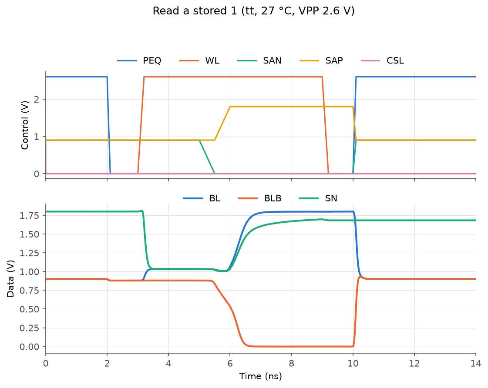

| tt, 27 °C, VDD 1.8 V | read 1 | read 0 |
|---|---|---|
| bitline signal ΔV after charge sharing | **+152.6 mV** | **−131.9 mV** |
| sense time (enable → 80% split) | 1.40 ns | 1.65 ns |
| cell level after restore | 1.695 V | 0.000 V |
| precharge time (BL−BLB < 10 mV) | 168 ps | 167 ps |

**What the numbers say**

- **Charge sharing works as the theory predicts.** ΔV ≈ (VDD/2)·Cs/(Cs+Cbl). Fitting it gives an effective Cbl of 104.5 fF, so the bitline transistors add about 4.5 fF of junction capacitance (M2a).
- **Read 0 and read 1 are not symmetric.** The rising wordline couples through the access transistor's gate overlap capacitance into BL only. BLB has no cell, so it gets no matching kick. The result is a **+10.6 mV systematic offset** that helps "1"s and costs "0"s. Real arrays cancel it with a dummy wordline or dummy cell on the reference bitline.
- **Read 0 senses 0.25 ns slower.** The falling bitline carries the cell too (Cbl + Cs), and it starts from a lower common-mode voltage, which gives the NMOS pair less gate drive.
- **Writes work.** A 0 overwrites a stored 1 in 0.56 ns through column select, and both polarities read back with more than 130 mV of signal.

**Problem 1: precharge too slow.** With the equalize gate driven only to VDD, the precharge transistors see just VDD − VDD/2 = 0.9 V of gate drive, and the body effect raises their threshold. The bitlines are still **90 mV apart 4 ns after precharge starts**, and the next activate would start from an unbalanced pair. Driving PEQ from VPP fixes it: **168 ps**.

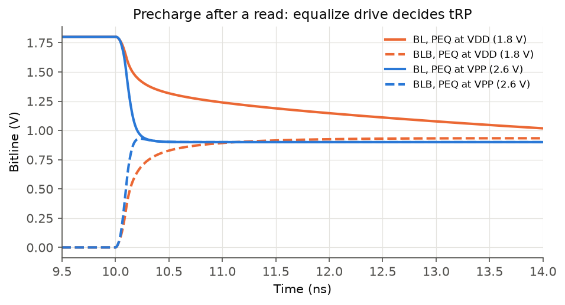

**Problem 2: "1" not fully restored.** The access NMOS stops conducting at about VPP − Vt, and Vt rises with the body effect as the storage node rises. At VPP = 2.6 V the cell restores to 1.695 V, costing about 12% of the next read's signal. **A full 1.8 V restore needs VPP ≥ 2.8 V.** Below about 2.0 V the cell barely connects to the bitline at all, and even the first read collapses (40 mV at VPP = 1.8 V).

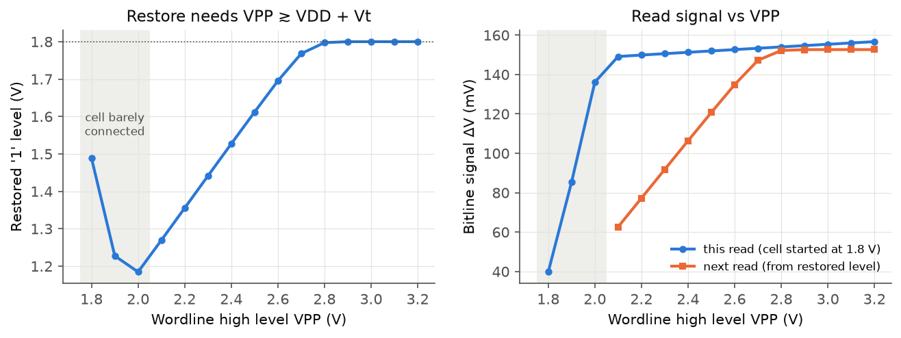

## 3. M2: signal vs Cs, retention, PVT corners

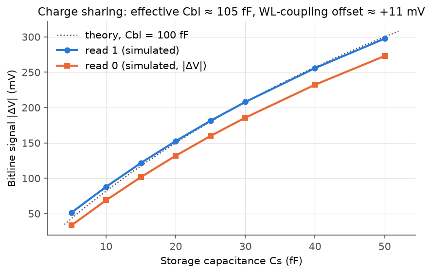

**Retention.** Computed from the cell's leakage current as t = ∫ Cs dV / I_leak(V), using DC leakage sweeps with gmin lowered to 1e-18 so fA currents aren't swamped by the simulator. A real transient at 125 °C agrees within 3% (1.69 vs 1.64 ms). A read fails when ΔV drops below 50 mV, which is about 6σ of the sense-amp offset.

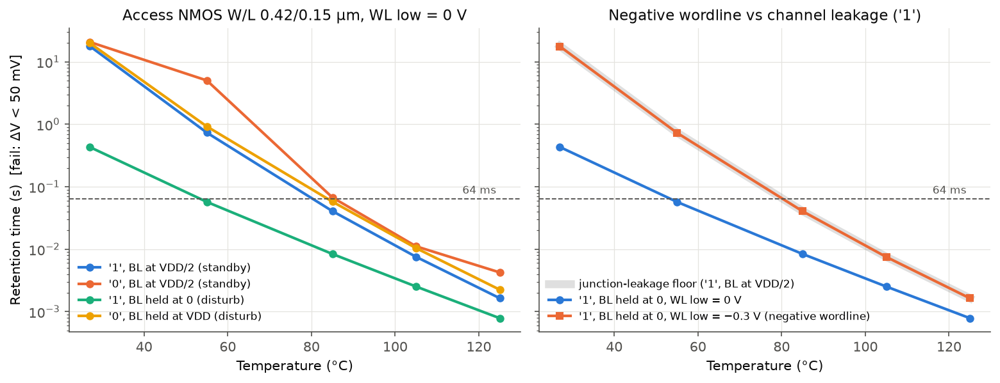

| access device / cell condition | 27 °C | 85 °C | 125 °C |
|---|---|---|---|
| "1", BL at VDD/2 (standby) | 17.9 s | 40.8 ms | 1.64 ms |
| "1", BL held at 0 (bitline disturb) | 433 ms | 8.4 ms | 0.79 ms |
| "1", BL at 0, **negative wordline (−0.3 V)** | 17.7 s | 40.6 ms | 1.64 ms |

- **The VDD/2 bitline already biases the access transistor off.** For a stored "1", the BL at VDD/2 is the transistor's source, so it sits at Vgs = −0.9 V and channel leakage is negligible. The **junction leakage** of the storage node sets retention instead.
- **The worst case is bitline disturb.** When neighbouring rows hold BL at 0, the transistor sits at Vgs = 0 with 1.8 V across it, and subthreshold leakage cuts retention 40× at room temperature.
- **A negative wordline fixes the disturb case.** At −0.3 V it removes the channel leakage, and retention falls back to the junction-leakage floor.
- **SKY130 is a logic process.** Even at that floor it misses 64 ms above about 80 °C. A real DRAM process engineers its junctions for low leakage.

**PVT corners.** 5 corners × 3 temperatures × 3 VDDs (±10%), read 1 and read 0, with VPP = VDD + 0.8 V: 90 simulations per sense-amp design.

> **Note on SKY130 corner names:** measured drive current shows `sf` = **fast NMOS / slow PMOS** and `fs` = slow NMOS / fast PMOS (`results/corner_check.csv`). The plots label corners by measured behaviour.

**Problem 3: sense-amp failure at ss / −40 °C / VDD 1.62 V.** The original latch (W 1/2 µm) **failed to resolve a "0"** and left the cell at 0.60 V: data corruption. VBLP = 0.81 V gives both latch pairs only about 0.1–0.2 V above their (cold, slow) thresholds, so regeneration stalls.

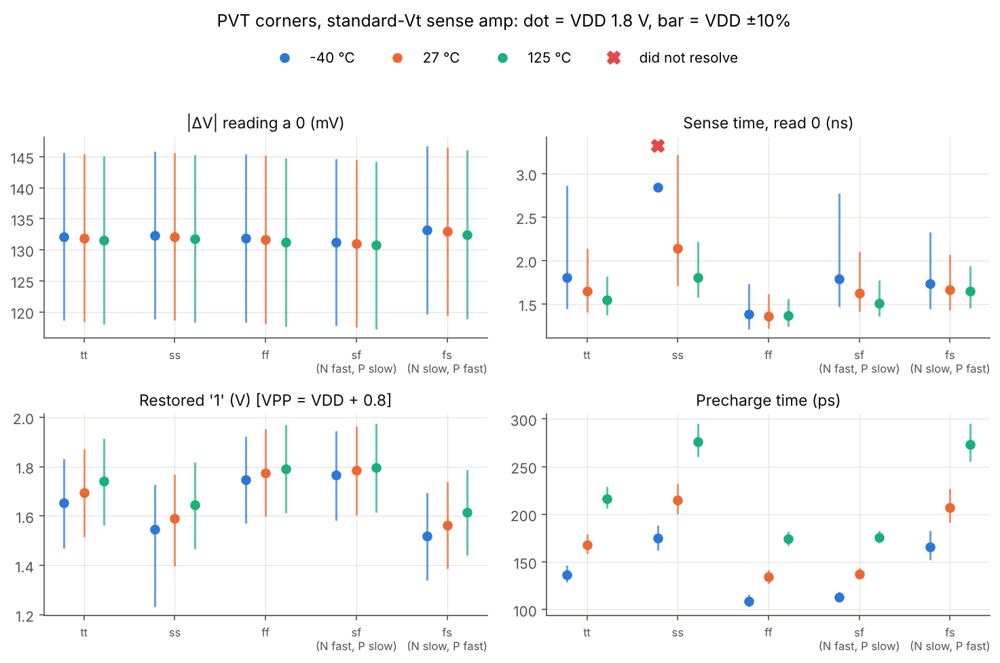

Two fixes were compared, both passing all 90 corner cases. Monte Carlo (M4) decides between them:

| sense amp | corner failures | worst ΔV (mV) | worst sense time | offset σ | 6σ offset | 6σ margin |
|---|---|---|---|---|---|---|
| standard-Vt, W 1/2 µm (original) | **1** | 117 | 3.84 ns | 10.8 mV | 65 mV | n/a (fails) |
| **standard-Vt, W 2/4 µm (chosen)** | 0 | 113 | 3.42 ns | **8.8 mV** | 53 mV | **+60 mV** |
| low-Vt, W 1/4 µm | 0 | 115 | 1.68 ns | 18.8 mV | 113 mV | **≈ 0 mV** |

Low-Vt devices are fast but have about 2× worse mismatch, so their 6σ offset uses up the entire signal. Doubling the width of the standard-Vt latch fixes the corner and lowers the offset. The costs are area and about 4 mV of signal, from the added bitline loading.

## 4. M3: 6T SRAM static margins

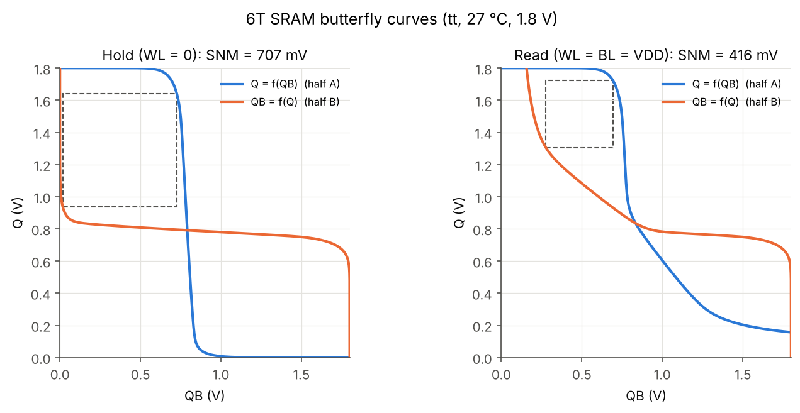

**tt, 27 °C:**

| metric | value |
|---|---|
| hold SNM | 707 mV |
| read SNM | 416 mV |
| write margin (BL voltage that flips the cell) | 628 mV |
| read current | 155 µA |

SNM uses Seevinck's rotated-butterfly method. A brute-force search for the largest embedded square agrees to 0.01 mV.

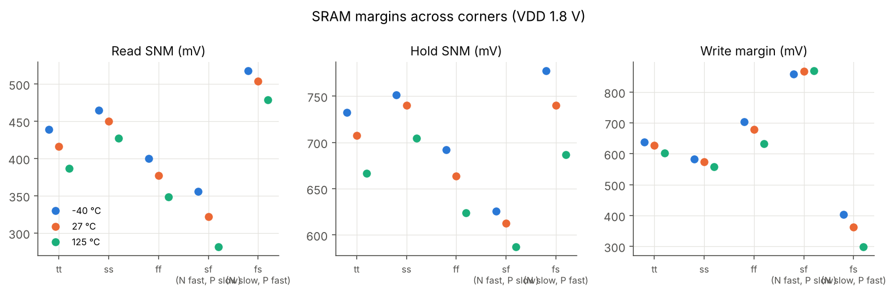

**Worst cases:**
- **Read SNM: 281 mV at sf (fast NMOS, slow PMOS), 125 °C.** The weak PMOS lowers each inverter's trip point, and read disturb pushes the "0" node closer to it.
- **Write margin: 299 mV at fs (slow NMOS, fast PMOS), 125 °C.** Here the strong pull-up fights the weak access transistor.

## 5. M4: Monte Carlo mismatch

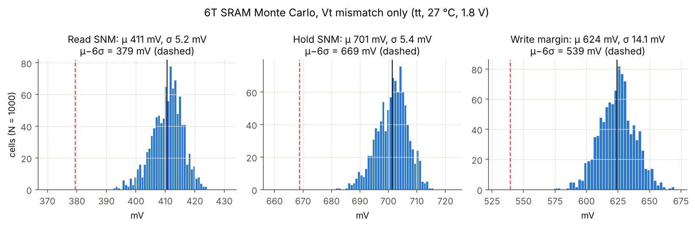
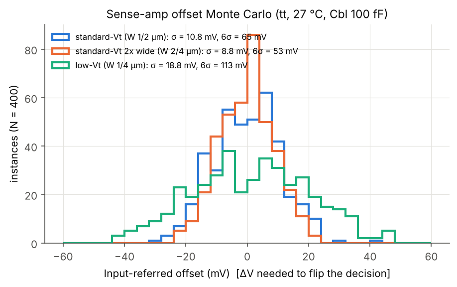

**Sense-amp offset:**
- Each instance's input-referred offset is found by a binary search on the bitline split.
- The offset is linear in the threshold shifts (fit residual 0.1 mV), with offset ≈ −0.91·(ΔVtn1 − ΔVtn2) + 0.16·(ΔVtp1 − ΔVtp2).
- The NMOS pair dominates because it fires first.

**SRAM:**
- Over 1000 cells, **read SNM** has μ = 411 mV and σ = 5.2 mV, so μ − 6σ = 379 mV.
- **Write margin** has μ − 6σ = 539 mV.
- At 1.8 V the cell has a lot of headroom.

## 6. M5: SystemVerilog real-number model

`rnm/dram_sa_rnm.sv` models the latch as:

- **Decision:** sign(V_BL − V_BLB − V_os).
- **Resolve time:** t = T0 + τ·ln(V_sw/|ΔV|), with a floor of T_min. This is the latch's exponential regeneration.
- **Metastability:** inputs below 50 µV are flagged as metastable, and the output stays X.

`scripts/m5_rnm.py` fits T0, τ and T_min from a SPICE sweep (0.5–400 mV, both polarities), writes `rnm/sa_params.svh`, and runs two Icarus Verilog testbenches:

| check | result |
|---|---|
| fitted parameters | T0 = 0.762 ns, **τ = 145 ps**, T_min = 0.952 ns |
| decisions vs SPICE | **44 / 44** |
| timing error, 1–100 mV | **2 ps rms**, 5 ps max (10 ps max over the full range) |
| statistical read test | 240,000 reads with V_os ~ N(0, 8.8 mV) in **1.8 s** |

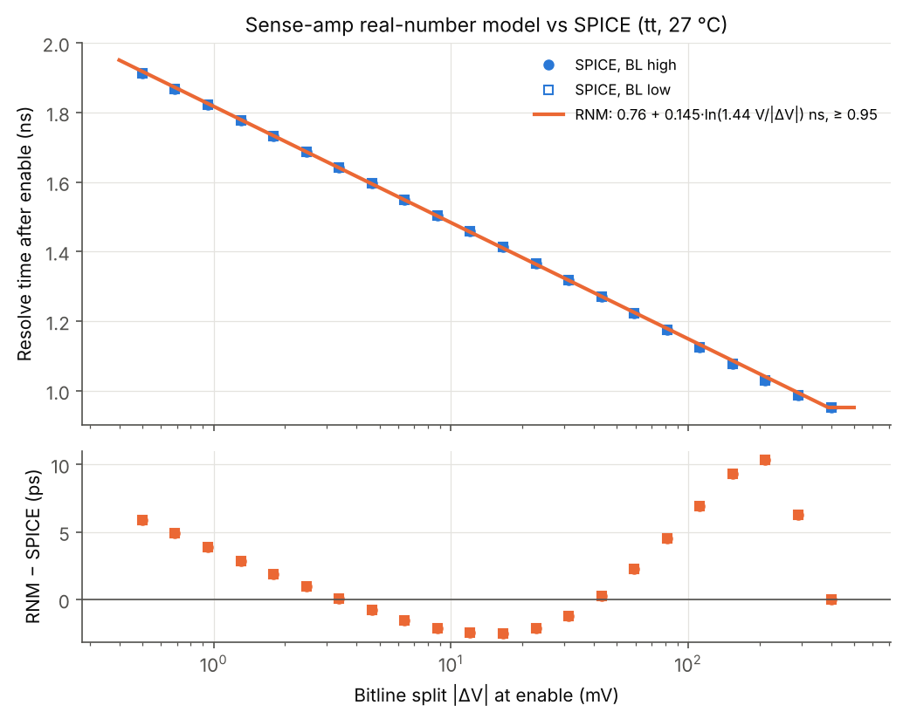
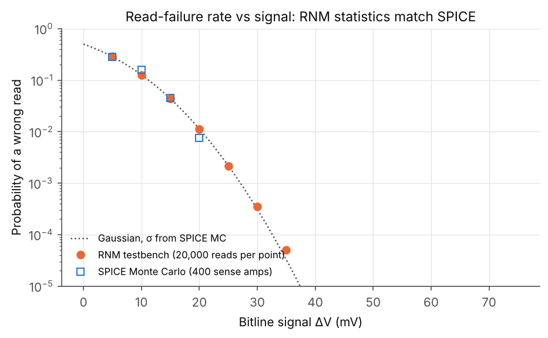

The RNM's failure rate vs. signal follows the Gaussian prediction and the 400-sample SPICE Monte Carlo. Running the same statistics in SPICE would take hours. This is the purpose of an RNM in mixed-signal verification: a model validated against SPICE first, then fast enough to use in system-level regressions.

## 7. Limitations

- **Mismatch is threshold-voltage only.** Each device gets a gate-series offset from N(0, A_Vt/√(WL)), using the PDK's own A_Vt coefficients (`spice.py`). Mobility and current-factor mismatch, and global process variation, are not included.
- **Device ratings.** VPP = 2.6–2.8 V on 1.8 V devices exceeds the oxide rating. A real design would use a thick-oxide access device and a regulated VPP. Oxide stress isn't modeled.
- **Parasitics.** Lumped Cbl with no wire resistance and no coupling between neighbouring bitlines.
- **Write margin in Monte Carlo** uses a slow transient ramp, which reads about 4 mV below the DC sweep at tt.

## 8. Reproduce

```bash
# tools: ngspice, iverilog (e.g. from OSS CAD Suite), python3 with numpy + matplotlib
pip install -r requirements.txt
export PDK_ROOT=$HOME/.ciel PDK=sky130A      # SKY130 via ciel (open_pdks build)
./run_all.sh            # all milestones, ~5-10 min; or e.g. ./run_all.sh m1 m5
cat results/summary.md
```

`SKY130_LIB=/path/to/sky130.lib.spice` overrides the model path.

PDK: SKY130A via ciel, open_pdks commit `<fill in from: ciel ls --pdk sky130>`.

```
scripts/spice.py          ngspice driver: netlist, run, .meas parsing, parallel runs, mismatch
scripts/dram.py           DRAM column netlist builder + timing
scripts/sram.py           6T cell netlists, Seevinck SNM, write margin
scripts/m1_dram.py ...    one script per milestone (m1-m5) + summary.py
rnm/dram_sa_rnm.sv        real-number sense-amp model
rnm/tb_sa_sweep.sv        RNM vs SPICE timing/decision testbench
rnm/tb_sa_yield.sv        statistical read-failure testbench
plots/  results/          generated outputs (results/summary.md = all headline numbers)
sim/                      generated netlists and ngspice logs
```

Author: Raj Balan Palanivel (JD), MS Computer Engineering, George Mason University.
